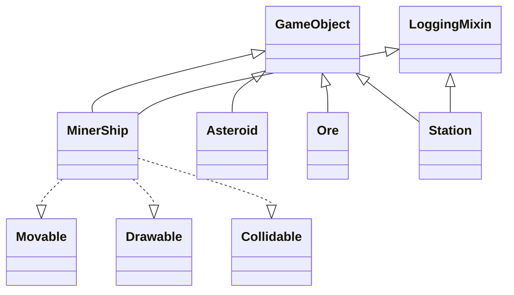

# Space Miner

Текстовая пошаговая игра: корабль добывает руду, продаёт на станции,
набирает кредиты. Победа — добыть всю руду до конца ходов.

## Быстрый старт

```bash
source .venv/bin/activate
pip install pytest pycodestyle
python main.py
pytest -v
```

## Как играть

Управление автоматическое — ИИ ведёт корабль к руде, а с полным
трюмом возвращает на станцию. Сложность задаётся конфигами.

- 🚀 корабль, 🏠 станция, ☄️ астероид, 💎 руда, · пустая руда.
- Проигрыш — кончилось топливо. Победа — вся руда добыта.

## Архитектура

- **ABC `GameObject`** (`core/game_object.py`) — общий контракт всех
  сущностей: уникальный `id`, `name`, `active`, абстрактные
  `update(dt)` и `draw()`. Нельзя инстанцировать напрямую.
- **Протоколы** (`core/protocols.py`) — способности:
  `Movable` (`move`), `Drawable` (`draw`), `Collidable`
  (`collision_radius`, `collides_with`). Все с `@runtime_checkable`,
  проверяются через `isinstance`.
- **Миксин** (`core/mixins.py`) — `LoggingMixin` для сквозных логов.
  Ставится первым: `class MinerShip(LoggingMixin, GameObject)`.



## Конфигурация

Все числа — в `core/config.py`, `@dataclass(frozen=True)`. В классах
магических чисел нет.

| Конфиг | Что настраивает |
|---|---|
| `GameConfig` | ходы, стоимость хода/добычи, цена руды, урон |
| `ShipConfig` | топливо, трюм, радиус |
| `AsteroidConfig` | радиус, урон |
| `OreConfig` | ценность, радиус |
| `LocationConfig` | размер и содержимое сектора |

Примеры сложности:

```python
from core.config import GameConfig, ShipConfig, AsteroidConfig
from game.game import Game

# Лёгкая: много ходов и топлива, слабый урон
easy = Game(
    game_config=GameConfig(max_turns=40, collision_damage=3),
    ship_config=ShipConfig(max_fuel=300, max_cargo=20),
    asteroid_config=AsteroidConfig(damage=3),
)

# Сложная: мало ходов и топлива, сильный урон
hard = Game(
    game_config=GameConfig(max_turns=15),
    ship_config=ShipConfig(max_fuel=50, max_cargo=5),
    asteroid_config=AsteroidConfig(damage=20),
)
```

Конфиги передаются в конструкторы снаружи (DI) — не создаются внутри
классов. `frozen=True` защищает от случайных правок:

```python
GameConfig().max_turns = 999   # FrozenInstanceError
```

## Логирование

Формат: `[ИмяКласса] LEVEL: сообщение`.

```
[MinerShip] INFO: Создан корабль Скиталец
[MinerShip] WARNING: Получен урон 10, топливо=89
[Station] INFO: Принято 3 ед., оплачено 15 кредитов (всего 15)
```

- Логируются `MinerShip` (движение, добыча, урон) и `Station` (продажа).
- Вывод — в `stderr` через стандартный `logging`.
- Выключить: `logging.disable(logging.CRITICAL)`.
- В файл: `logging.basicConfig(filename="game.log")`.
